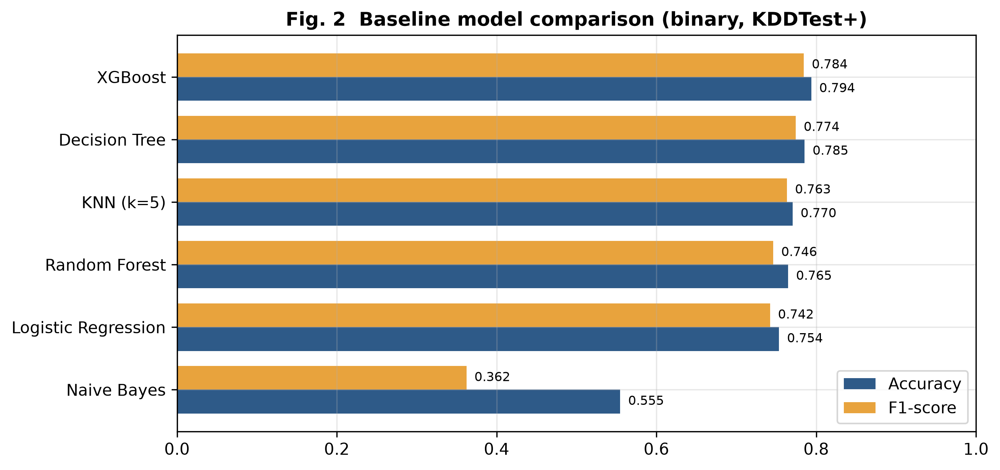
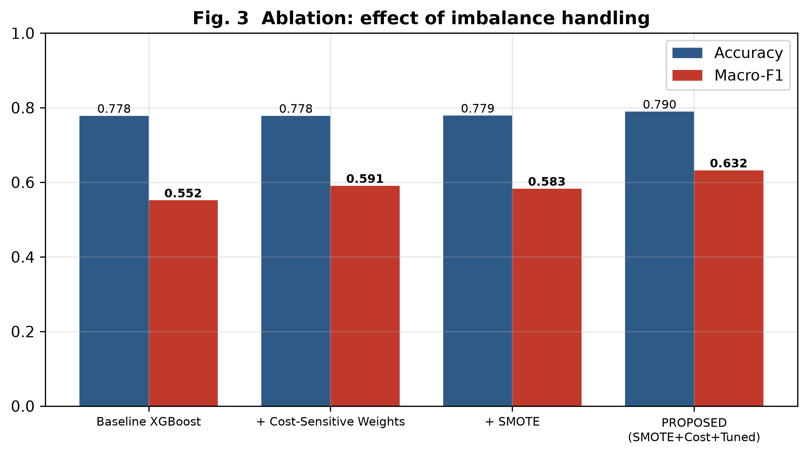
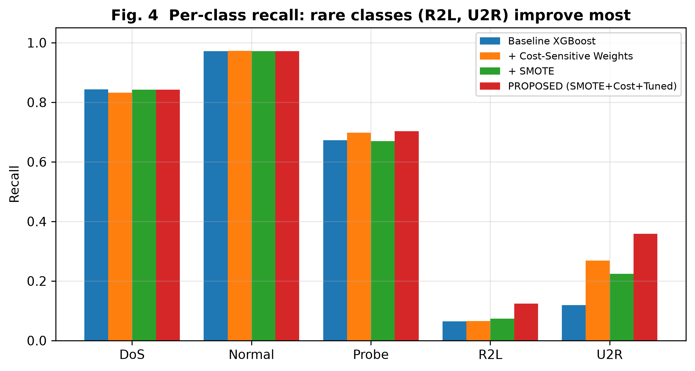

# Network Intrusion Detection with Class-Imbalance-Aware ML (NSL-KDD)

B.Tech CSE major project, Jaypee University of Information Technology (2026).

**The finding.** NSL-KDD papers often report 96-99% accuracy. Those numbers come from randomly splitting
KDDTrain+, so train and test share one distribution. On the official, disjoint KDDTrain+ -> KDDTest+ protocol
the same models reach 77-79%, because the rare attack classes are far more frequent in the test set
(R2L 2.9x, U2R 1.3x). A SMOTE + cost-sensitive + tuned XGBoost pipeline lifts macro-F1 from 0.552 to 0.632 and
triples U2R recall without hurting the majority classes.

## Data

NSL-KDD: 125,973 training and 22,544 test records, 41 features. The dataset is not in this repository: download
`KDDTrain+.txt` and `KDDTest+.txt` from the [Canadian Institute for Cybersecurity](https://www.unb.ca/cic/datasets/nsl.html)
into `data/`.

| Class | Train | Test | Test/Train ratio |
|---|---:|---:|---|
| Normal | 67,343 | 9,711 | |
| DoS | 45,927 | 7,460 | |
| Probe | 11,656 | 2,421 | |
| **R2L** | **995** | **2,885** | **2.9x more in test** |
| **U2R** | **52** | **67** | **1.3x more in test** |

## Baselines: binary (Normal vs Attack), official split

| Model | Accuracy | Precision | Recall | F1 | FPR | ROC-AUC |
|---|---:|---:|---:|---:|---:|---:|
| **XGBoost** | **0.7938** | 0.9683 | 0.6593 | **0.7845** | 0.0285 | 0.9701 |
| Decision Tree | 0.7854 | 0.9648 | 0.6467 | 0.7743 | 0.0312 | 0.8079 |
| KNN (k=5) | 0.7704 | 0.9234 | 0.6507 | 0.7635 | 0.0714 | 0.8197 |
| Random Forest | 0.7648 | 0.9670 | 0.6075 | 0.7462 | 0.0274 | 0.9594 |
| Logistic Regression | 0.7535 | 0.9173 | 0.6232 | 0.7421 | 0.0742 | 0.7801 |
| Naive Bayes | 0.5546 | 0.9801 | 0.2222 | 0.3622 | 0.0060 | 0.7992 |

Precision is high (~0.97) and recall low (~0.66): the models miss about a third of real attacks, which is the
costly error for an intrusion detection system. In the multi-class view, R2L recall is 0.03.

## Proposed method

1. **SMOTE** on R2L and U2R (5,000 samples each, k=3), on training data only.
2. **Cost-sensitive learning** with inverse-frequency sample weights.
3. **Tuned XGBoost**: 300 estimators, depth 10, learning rate 0.08, subsample 0.9, colsample 0.8.

| Method | Accuracy | Macro-F1 |
|---|---:|---:|
| Baseline XGBoost | 0.7783 | 0.5516 |
| + Cost-sensitive weights | 0.7783 | 0.5906 |
| + SMOTE | 0.7790 | 0.5829 |
| **Proposed (SMOTE + cost + tuned)** | **0.7896** | **0.6320** |

| Recall | DoS | Normal | Probe | **R2L** | **U2R** |
|---|---:|---:|---:|---:|---:|
| Baseline XGBoost | 0.8434 | 0.9711 | 0.6729 | 0.0648 | 0.1194 |
| **Proposed** | 0.8420 | 0.9715 | **0.7030** | **0.1244** | **0.3582** |





## Limitations

- R2L recall is still only 0.12: SMOTE interpolates between existing samples and cannot invent attack signatures
  that never appear in training.
- Accuracy (~0.79) is far below the 96%+ in the literature. That is the honest number under the official protocol.
- Normal-class precision is 0.70, so false alarms remain a deployment concern.

Next: anomaly detection (autoencoder / one-class SVM) for unseen attack types, feature selection, cross-dataset
validation on CICIDS2017 / UNSW-NB15, and 5-fold CV with significance tests.

## Reproduce

```bash
pip install -r requirements.txt
python src/experiment.py binary
python src/experiment.py multiclass
python src/proposed.py
python src/figures.py
```

All runs use `random_state=42`.

| Path | Contents |
|---|---|
| `src/data_loader.py` | Loading, attack taxonomy, preprocessing |
| `src/experiment.py` | Six-model baseline comparison |
| `src/proposed.py` | Ablation study of the proposed method |
| `src/figures.py` | Figures |
| `results/` | Metrics (CSV/JSON) and figures |
